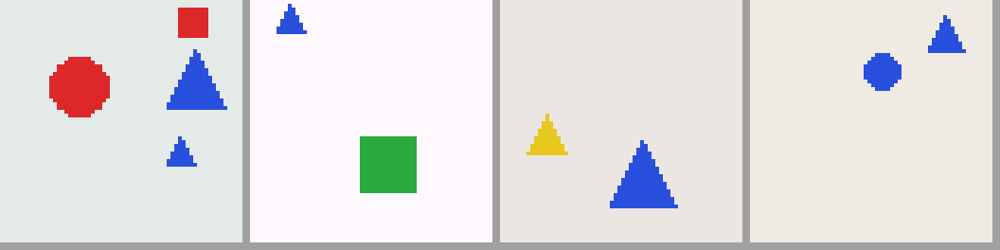

# 第 0 章　全景：视觉语言模型与 OCR 是什么，这本书怎么学

## 本章在全景图中的位置

这是第一章，还没有任何零件。本章做三件事：画出整张地图（VLM 和 OCR 都由哪些部分组成、现实中的模型是怎么训练出来的）；把环境搭好；讲清楚这本书的学法。读完以后，你应该知道接下来几十章每一章"为什么要学"。

## 学习目标

读完并做完本章，你应该能够：

1. 用自己的话说出：什么是模型、什么是训练、什么是视觉语言模型（VLM）、什么是 OCR；
2. 说出 OCR 的两条技术路线（"流水线"与"端到端"）各自的做法和优缺点；
3. 说出一个真实 VLM 通常经过哪几个训练阶段，每个阶段的数据和目的是什么；
4. 在自己的电脑上搭好环境，运行第一个检查脚本和第一组自动测试；
5. 知道每一章的学习节奏，知道什么时候该自己写、什么时候可以看参考答案。

## 前置检查

本章没有前置要求。只要你会打开终端（Windows 上叫"命令提示符"或 PowerShell，Mac 和 Linux 上叫"终端"）、会输入命令并按回车，就可以开始。

---

## 0.1 从一个具体的问题出发

假设你手里有一张拍下来的数学作业，上面有一个公式：

```
   a + 1
  ─────── = x²
     b
```

你希望电脑把它变成可以编辑、可以搜索的文字，比如 LaTeX 格式（第 3 章会详细讲 LaTeX）：

```
\frac{a+1}{b}=x^{2}
```

再假设你手里有一张照片，里面有一个红色的圆和一个蓝色的方块，你问电脑："图里有几个物体？红色的那个在哪里？"你希望它回答："两个；红色的圆在左边。"

这两件事有一个共同点：**输入是图像，输出是文字**。能做这类事情的模型，就叫**视觉语言模型**（Vision-Language Model，简称 **VLM**）。第一件事——把图里的文字、公式、表格"读"出来——有一个专门的名字，叫 **OCR**（Optical Character Recognition，光学字符识别）。

这本书的目标是：**让你从零开始，亲手理解并训练这样的模型。** 最后你会读懂一个真实的、最先进的 OCR 模型（小米的 Xiaomi-OCR-0）的完整训练配方，并在小规模上复现它的关键做法。

在出发之前，我们先把几个最基本的词弄清楚。

## 0.2 模型、参数与训练

### 模型是一个带旋钮的函数

你在中学学过函数：`y = f(x)`，给一个输入 `x`，得到一个输出 `y`。比如 `f(x) = 2x + 1`，输入 3，输出 7。

**模型**也是一个函数，只不过：

- 它的输入可以很复杂：一张图（几万个数字）、一句话（一串字符）；
- 它的输出也可以很复杂：一个类别、一段文字；
- 它里面有很多可以调节的数字，叫做**参数**（parameters）。

继续用 `f(x) = 2x + 1` 打比方：如果把 2 和 1 换成可以调节的数 `w` 和 `b`，写成 `f(x) = w·x + b`，那 `w` 和 `b` 就是这个"模型"的两个参数。不同的 `w`、`b` 给出不同的函数：`w=2, b=1` 时输入 3 得 7；`w=-1, b=0` 时输入 3 得 -3。

你可以把参数想象成收音机上的旋钮：同一台收音机，旋钮拧到不同位置，收到不同的电台。一个真实的 VLM 有几亿到几百亿个参数——几亿个旋钮。本书最后接触的 Xiaomi-OCR-0 有大约 8 亿个参数（0.8B，B 是 billion，十亿）。

### 训练就是自动拧旋钮

几亿个旋钮，人不可能手动去拧。**训练**就是让电脑根据大量例子，自动把旋钮拧到合适的位置。每一轮训练做四件事：

1. **预测**：把一个例子的输入（比如一张公式图）交给模型，得到模型的输出；
2. **算损失**：把模型的输出和正确答案比较，用一个数衡量"错了多少"。这个数叫**损失**（loss），越小越好；
3. **算梯度**：算出"每个旋钮往哪个方向拧一点点，损失会变小"。这组方向叫**梯度**（gradient）；
4. **更新**：把每个旋钮朝那个方向拧一小步。

这四步重复成千上万次，模型的输出就越来越接近正确答案。第 5 章会用中学数学讲清楚"梯度"是什么，第 7、8 章你会亲手写出这个过程，第 10 章你会用它训练出第一个能认字的模型。

> **一个小例子，帮你建立直觉。** 假设模型是 `f(x) = w·x`（只有一个旋钮 `w`），例子是"输入 2，正确答案 6"。现在 `w = 1`，模型输出 2，错了 4。如果把 `w` 拧大一点（比如 1.1），输出变成 2.2，离 6 更近了。所以"往大拧"就是梯度告诉我们的方向。拧多大一步，由一个叫**学习率**的数决定。重复几次，`w` 会接近 3，这时输出 6，损失为 0。真实的训练和这个例子的道理完全一样，只是旋钮多了几亿倍。

### 数据、训练集与测试集

训练需要例子，大量的例子合起来叫**数据集**。一个数据集通常分成三份：

| 名字 | 用途 | 打个比方 |
|---|---|---|
| **训练集** | 用来拧旋钮 | 平时做的练习题 |
| **验证集** | 训练过程中检查效果、选择设置 | 模拟考试 |
| **测试集** | 最后评一次分，看模型在没见过的数据上表现如何 | 正式考试 |

为什么要分开？如果用练习题本身去考试，学生背下答案就能拿满分，但这说明不了他真的会。模型也一样：在训练集上表现好不稀奇，**在没见过的数据上表现好**才说明它学到了规律。第 25 章会专门讲"数据怎么分才公平"——这是很多研究出错的地方。

## 0.3 视觉语言模型能做什么

VLM 的输入是"图像 + 一段文字（指令或问题）"，输出是一段文字。换不同的指令，同一个模型可以做很多事：

| 任务 | 指令示例 | 输出示例 | 本书在哪里讲 |
|---|---|---|---|
| **图像描述**（captioning） | "描述这张图。" | "一个大的红色圆形，一个小的蓝色方块。" | 第 22、23 章 |
| **视觉问答**（VQA） | "图里有几个三角形？" | "2" | 第 23 章 |
| **视觉定位**（grounding） | "绿色方块在哪里？" | `<box>(12,40),(30,58)</box>`（一个矩形框的坐标） | 第 23 章 |
| **OCR：文字识别** | "提取图中的文字。" | "hello world 42" | 第 13、22 章 |
| **OCR：公式识别** | "用 LaTeX 写出图中的公式。" | `\frac{a+1}{b}=x^{2}` | 第 3、26 章 |
| **OCR：表格识别** | "把表格转成 HTML。" | `<table><tr><td>…` | 第 25、33 章 |
| **文档解析** | "把这一页转成 Markdown。" | 整页的标题、段落、公式、表格，按阅读顺序排好 | 第 21、33 章 |
| **OCR 问答** | "这张收据的总金额是多少？" | "42.50" | 第 23、33 章 |

注意最后一列：**通用 VLM 和 OCR 用的是同一套技术**。OCR 可以看作 VLM 的一个特别重要、特别"较真"的应用：描述一张图时说"一个红色的圆"或"一个红圆"都算对，但 OCR 把 `x^2` 读成 `x^3` 就是错的。所以 OCR 对**细节**（小字、上下标、对齐）要求极高，对**评测**（怎样判断对错）也要求极高。这两点会贯穿全书。

## 0.4 OCR 的两条技术路线

在 VLM 出现之前，OCR 已经发展了几十年。今天的 OCR 系统大致分两条路线，理解它们的区别，是理解这个领域的钥匙。

### 路线一：流水线（pipeline）

把"读一页文档"拆成几个独立的步骤，每一步用一个专门的模型：

```
整页图像
   │
   ▼ ① 版面分析：找出页面上的区块（标题、段落、表格、公式、图片），给每个区块画一个框
   │
   ▼ ② 文字检测：在文字区块里，找出每一行文字的位置
   │
   ▼ ③ 文字识别：把每一行裁出来，识别成字符串（经典方法：CNN + RNN + CTC，第 13 章）
   │   公式区块交给公式识别模型，表格区块交给表格识别模型
   ▼ ④ 阅读顺序与拼装：按人读的顺序把各区块的结果拼成一篇文档
   │
   ▼
Markdown / HTML 文档
```

- **优点**：每一步都可以单独改进、单独评测；每个模型可以很小、很快；出了错容易定位是哪一步的问题。
- **缺点**：步骤之间的错误会**累积**（版面分析漏掉一个公式，后面再好也没用）；每一步都要单独的标注数据；很难处理需要"整体理解"的情况。

### 路线二：端到端（end-to-end）的 VLM

用一个 VLM 直接把图像变成最终的文字：

```
图像 + 指令（"把这一页转成 Markdown"）  ──▶  VLM  ──▶  Markdown 文本
```

- **优点**：一个模型、一套训练流程；能利用上下文（比如根据前后文猜出模糊的字）；同一个模型还能做问答等"理解"任务。
- **缺点**：模型大、慢；整页图像会变成很多"视觉 token"，计算量大（第 22、24 章会算）；出错时不好定位；可能"编造"图里没有的内容（幻觉，第 23、30 章）。

### 现实：两条路线在融合

今天最好的文档 OCR 系统，很多是**两阶段的混合**：先用一个小的版面检测模型把页面切成区块（流水线的第 ① 步），再用一个 VLM 识别每个区块（端到端地完成 ②③）。本书最后精读的 Xiaomi-OCR-0 就是这样：它的技术报告写明，用一个外部的版面检测器（PP-DocLayoutV3）找区块，再用 0.8B 的 VLM 识别区块内容；同一个 VLM 也能直接处理整页。

所以本书**两条路线都会讲**：第 13 章写一个经典的 CTC 文字识别器，第 21 章写一个最小的检测器、跑通一条完整的流水线，第 22 章开始搭 VLM，第 33 章比较这两类文档解析系统。

## 0.5 一个 VLM 由哪几部分组成

几乎所有主流 VLM 都是同一个"三件套"结构：

```
图像
 │  ① 视觉编码器（vision encoder）：把图像切成小方块（patch），每块变成一个向量，
 │     再用 Transformer 让每块"看到"其他块（第 12、19 章）
 ▼
一串"视觉向量"
 │  ② 连接器（connector / projector / merger）：把视觉向量变成语言模型能"读"的形状，
 │     常常顺便把数量减少（比如每 2×2 个合成 1 个）（第 22 章）
 ▼
一串"视觉 token"  ─┐
                  ├─▶ ③ 语言模型（language model）：就是一个会"接着往下写"的文字模型，
指令的文字 token ─┘     它把视觉 token 和文字 token 当成同一个序列来读，然后逐字写出回答
                        （第 14–17 章）
                        ▼
                     回答的文字
```

三个部分各有来历：

- **语言模型**本来是在海量文字上训练出来的，它已经会"说话"、懂语法和常识（第 16 章你会训练一个小的）；
- **视觉编码器**本来是在海量"图片—说明文字"配对上训练出来的，它已经会"看"——能把内容相近的图变成相近的向量（第 20 章的对比学习）；
- **连接器**一开始什么也不会，它的任务是当"翻译"：把视觉编码器的输出，翻译成语言模型能理解的"词"。

**为什么要这样拼，而不是从零训练一个大模型？** 因为从零训练太贵了：语言能力需要几万亿个字的文本，视觉能力需要几十亿张图。把两个已经训练好的部件接起来，只需要相对少的数据，教会它们"互相理解"就行。第 22 章会用实验对比"从零训练"和"预训练部件 + 对齐"的差别。

## 0.6 一个真实的 VLM 是怎么训练出来的

把上面的三件套训练成一个好用的 VLM，通常分几个阶段：

| 阶段 | 训练什么 | 用什么数据 | 目的 | 本书在哪里 |
|---|---|---|---|---|
| 0. 部件预训练 | 语言模型；视觉编码器 | 海量文本；海量图文对 | 让两个部件各自有本事 | 第 16、20 章 |
| 1. 对齐预训练 | 通常只训连接器（另两个冻结） | 大量"图—描述"配对 | 让语言模型"看懂"视觉 token | 第 22 章 |
| 2. 指令微调（SFT） | 连接器 + 语言模型（有时也包括视觉编码器） | 各种任务的"指令—回答"配对 | 学会按指令做具体任务 | 第 23、26 章 |
| 3. 偏好优化 / 强化学习 | 通常是语言模型 | 偏好对；可以自动打分的任务 | 让回答更准确、更少幻觉、更符合要求 | 第 29–31 章 |

**冻结**（freeze）的意思是：这个部件的参数在这个阶段不变，不参与训练。为什么阶段 1 只训连接器？因为一开始连接器的输出是乱的，如果这时也训语言模型，乱七八糟的输入会把语言模型原有的本事"带坏"。先把连接器训到能用，再一起训，更稳。第 22 章会用实验检验这个说法。

### 以 Xiaomi-OCR-0 为例

Xiaomi-OCR-0 是一个 0.8B 参数的 OCR 模型，它的技术报告（2026 年发布）公开了训练配方。它不是从零开始，而是从一个已经训练好的通用 VLM——Qwen3.5-0.8B——出发，接着训练了三个阶段：

1. **文本锚定（Q-Mask）**：除了让模型写出图里的文字，还让它指出"这段文字在图里的哪个位置"（输出一个像素级的掩码）。这样模型就把"文字内容"和"空间位置"对应了起来；
2. **持续预训练**：用大约 1.7 亿条 OCR 相关的样本继续训练，以文档解析为主，再加上 OCR 问答、手写体、图表等数据；
3. **混合任务强化学习（Mix-RL）**：对文字、表格、公式、整页、问答等不同任务，用不同的自动打分规则（比如公式用 CDM 指标、表格用 TEDS 指标）当作奖励，用强化学习继续提升。

它还有一个**数据引擎**：用 8 个现有的 OCR 模型给同一批图片打标签，取它们"意见最一致"的结果作为标签；对不确定的样本，把标签"渲染"回图像，和原图比对来检查对错。

现在这些名词你大多还不认识，没关系。第 34 章会逐节精读这份报告，那时你会发现：**它的每一步，都是本书前面某一章讲过的通用方法**——对比学习、指令微调、定位监督、多任务训练、可验证奖励的强化学习、伪标签与集成。这就是本书的安排：**先学通用的方法，再看真实的模型怎样把它们组合起来。**

## 0.7 代表性模型一览

你会在书里不断遇到下面这些名字。不需要记住，用到时回来查即可。

| 年份 | 模型 / 方法 | 一句话 | 本书哪里讲 |
|---|---|---|---|
| 2006 | CTC | 一种训练方法：不需要知道每个字符在图里的确切位置，就能训练文字识别 | 第 13 章 |
| 2015 | CRNN | CNN 提取特征 + RNN 读序列 + CTC 训练，经典的文字行识别器 | 第 13 章 |
| 2017 | Transformer | 用"注意力"处理序列的网络结构，今天几乎所有大模型的基础 | 第 15、16 章 |
| 2020 | ViT | 把图像切成小方块，当成"词"交给 Transformer | 第 19 章 |
| 2021 | CLIP | 用 4 亿对"图片—说明文字"做对比学习，训练出强大的视觉编码器 | 第 20 章 |
| 2022 | Flamingo | 在语言模型里插入"交叉注意力"层来看图 | 第 22 章 |
| 2022 | Donut | 不经过传统 OCR 步骤，直接从文档图像生成结构化文字的端到端模型 | 第 33 章 |
| 2023 | BLIP-2 | 用一组可学习的"查询向量"（Q-Former）从视觉特征里提取信息 | 第 22 章 |
| 2023 | LLaVA | 用一个简单的投影层把视觉向量接到语言模型上；两阶段训练（对齐 + 指令微调）的代表 | 第 22 章 |
| 2023 起 | Qwen-VL 系列 | 支持任意分辨率的输入；相邻 2×2 个 patch 合并成 1 个视觉 token | 第 22、24 章 |
| 2023 | SigLIP | 把 CLIP 的损失换成逐对的 sigmoid 损失 | 第 20 章 |
| 2024–2026 | 文档解析模型（MinerU、PaddleOCR-VL、dots.ocr、GLM-OCR 等） | 流水线与端到端的各种组合，专门针对文档 | 第 33 章 |
| 2026 | Xiaomi-OCR-0 | 从 Qwen3.5-0.8B 出发，锚定 + 持续预训练 + 混合任务强化学习 | 第 34 章 |

## 0.8 这本书怎么带你走完这条路

### 一个项目、两个玩具世界

真实的 VLM 太大，在个人电脑上训练不动；而且真实数据很"脏"，初学时会让人分不清问题出在方法上还是数据上。所以本书大部分章节使用**两个合成的"玩具世界"**：

- **ShapesWorld**：几何图形组成的场景（圆、方块、三角形，四种颜色，两种大小）。用来学通用 VLM：描述、问答、定位、多图、幻觉；
- **MiniDoc**：渲染出来的字符、文字行、公式、小表格和"页面"。用来学 OCR 和文档解析。内容只包含**英文字母、数字和数学符号**——本书不涉及多语言文字和视频、语音，把篇幅留给通用 VLM 与 OCR 本身的广度和深度。



玩具世界的好处是：**每张图的标准答案都是精确已知的**（图是我们自己画的），所以训练和评测都非常干净；图很小，模型也很小，在笔记本电脑上几分钟就能训练完。它们的局限也很明显——真实世界复杂得多。所以第 24 章和第 33–35 章会回到真实的模型和数据，检验在玩具世界学到的东西。

全书的代码都在一个叫 `miniocr` 的代码库里。每一章往里面加一个零件：第 2 章加渲染器，第 8 章加自动求导，第 16 章加语言模型，第 19 章加视觉编码器，第 22 章把它们拼成 VLM……到最后，你手里会有一个自己从零写出来的、完整的 VLM 训练框架。

### 全书地图

```
第 0 部分　准备            0 全景   1 Python 与 NumPy   2 图像就是数组   3 文本与结构化输出
                                │
第一部分　数学              4 向量矩阵   5 导数梯度   6 概率与交叉熵
                                │
第二部分　神经网络          7 梯度下降   8 自动求导   9 PyTorch   10 训练循环（第一个认字模型）
                            11 优化与数值稳定   12 卷积神经网络
                                │
第三部分　序列与语言模型    13 文字行识别（CTC）   14 分词与语言建模   15 注意力   16 GPT
                            17 生成与 KV cache   18 训练工程
                                │
第四部分　视觉编码器        19 ViT   20 对比学习（CLIP/SigLIP）   21 检测与版面分析
                                │
第五部分　视觉语言模型      22 搭一个 VLM   23 VLM 的任务与指令数据   24 真实 VLM 解剖
                                │
第六部分　评测与监督微调    25 评测   26 VLM 的监督微调   27 回答的对数概率   28 显存与 LoRA
                                │
第七部分　偏好与强化学习    29 强化学习基础   30 DPO   31 GRPO 与可验证奖励   32 遗忘与能力配比
                                │
第八部分　文档 OCR 与真实世界  33 文档解析与数据工程   34 案例精读：Xiaomi-OCR-0
                               35 搬到真实模型   36 毕业项目
```

前三部分（第 1–18 章）是地基。你可能会着急："什么时候才开始讲 VLM？"请耐心：第 22 章搭 VLM 时，你会用到前面每一章的东西——图像数组、矩阵乘法、梯度、训练循环、卷积、注意力、语言模型。地基打得越牢，后面越轻松。

## 0.9 搭建环境

### 你需要什么

| 设备 | 能做什么 |
|---|---|
| 任何一台 8GB 内存以上的电脑（Windows、Mac、Linux） | 第 0–34 章的全部实验（每个实验都有"CPU 小配置"，用 CPU 也能跑完） |
| 一块 NVIDIA 显卡（本书用的是 RTX 5080，16GB 显存） | 实验快很多；第 35 章在真实模型上做微调时最有用（没有显卡也能在 CPU 上跑，只是慢；trl 的 trainer 在本书的版本里只能用 GPU） |
| Apple 芯片的 Mac（M1 及以后） | 可以用 `mps` 加速大部分实验 |

作者的机器是 Linux + RTX 5080，但这块显卡同时在跑别的程序，所以书里的"实测输出"**大多是在 CPU 上得到的**；用了 GPU 的地方（比如第 9 章的测速）会注明。你的数字会和书上略有不同（随机性、硬件不同），但**趋势应该一致**；如果差得很远，多半是代码有问题。

### 第一步：安装 uv

`uv` 是一个管理 Python 版本和依赖库的工具。它的官方安装命令是：

```bash
curl -LsSf https://astral.sh/uv/install.sh | sh                                   # macOS、Linux
powershell -ExecutionPolicy ByPass -c "irm https://astral.sh/uv/install.ps1 | iex"  # Windows（PowerShell）
```

如果电脑上已经有 Python 和 pip，也可以用 `pip install uv`。装好以后打开一个**新的**终端，输入：

```bash
uv --version
```

应该看到一个版本号，例如 `uv 0.9.x`。如果提示"找不到命令"（command not found），说明还没装好，或者需要重新打开终端。

### 第二步：准备代码和虚拟环境

把本书的 `course-v3` 文件夹放到你喜欢的位置，然后在终端里进入它：

```bash
cd course-v3                          # cd = change directory，进入这个文件夹
uv venv --python 3.12 .venv           # 在 .venv 文件夹里建一个独立的 Python 3.12 环境
source .venv/bin/activate             # 激活它（Windows：.venv\Scripts\activate）
```

**虚拟环境**是什么？它是一个只属于这个项目的 Python 安装。你在里面装的库不会影响电脑上的其他程序，其他程序也不会影响它。激活之后，终端提示符前面会出现 `(.venv)`。**以后每次打开新终端学习本书，都要先 `cd` 到 `course-v3` 并执行一次 `source .venv/bin/activate`。**

### 第三步：安装依赖库

```bash
uv pip install -r requirements.txt
```

`requirements.txt` 里列出了本书用到的库和实测过的版本：

| 库 | 作用 | 从第几章开始用 |
|---|---|---|
| `numpy` | 数组计算（图像、矩阵都是数组） | 第 1 章 |
| `pillow` | 画图、读写图片 | 第 2 章 |
| `matplotlib` | 画曲线图 | 第 5 章 |
| `pytest` | 运行自动检查 | 本章 |
| `torch`（PyTorch） | 深度学习框架：自动求导、GPU 计算 | 第 9 章 |

> **关于 PyTorch 的版本**：PyTorch 有 CPU 版和不同 CUDA 版本的 GPU 版，GPU 版要和你的显卡驱动匹配。可以在运行上面的命令**之前**，先单独装好 torch：
>
> ```bash
> uv pip install torch==2.14.1 --index-url https://download.pytorch.org/whl/cpu     # 没有 NVIDIA 显卡：CPU 版，下载最小
> uv pip install torch==2.14.1 --index-url https://download.pytorch.org/whl/cu130   # NVIDIA 显卡、驱动支持 CUDA 13.0（本书用的是这个）
> ```
>
> 驱动支持的最高 CUDA 版本看 `nvidia-smi` 输出右上角的 "CUDA Version"。驱动较旧时，把 `cu130` 换成更低的版本（PyTorch 官网首页的安装选择器列出了这个版本的 torch 提供哪些 CUDA 版本）。Apple 芯片的 Mac 直接 `uv pip install -r requirements.txt` 即可，自带 `mps` 支持。

### 第四步：运行环境检查

```bash
python -m labs.ch00.check_env
```

在本书作者的机器上，输出是：

```
Python 3.12.3（Linux x86_64）
NumPy 2.5.4，Pillow 12.3.0
PyTorch 2.14.1+cu130
  CUDA 可用: True（NVIDIA GeForce RTX 5080，显存 15.5 GiB）
  MPS 可用: False
  在 cuda 上做了一次 256×256 的矩阵乘法，结果与 CPU 相差 3.05e-05

ShapesWorld 的 4 张场景图已保存到 outputs/ch00/shapesworld.png，它们的描述是：
   a large red circle, a large blue triangle, a small blue triangle, a small red square
   a small blue triangle, a large green square
   a small yellow triangle, a large blue triangle
   a small blue circle, a small blue triangle
MiniDoc 的 4 张公式图已保存到 outputs/ch00/minidoc_formulas.png，它们的 LaTeX 是：
   5x+8=8
   k^{2}-6_{x}-a_{a}
   \frac{n+7}{z}
   6+(n+9)=\sqrt{8b-9c}

环境检查完成。
```

逐行看懂它：

- **CUDA 可用**：`True` 表示 PyTorch 找到了 NVIDIA 显卡。没有显卡时是 `False`，完全没关系。
- **MPS 可用**：Apple 芯片的 Mac 上会是 `True`。
- **"结果与 CPU 相差 3.05e-05"**：同一个矩阵乘法，在显卡和 CPU 上算出的结果差了大约十万分之三。这不是错误。电脑用有限的位数表示小数（第 11 章会讲 fp32 格式），每做一次加法都有一点点舍入误差；矩阵乘法要做很多次加法，而显卡和 CPU **做加法的顺序不同**，舍入误差就积累得不一样。作者另外用更精确的 64 位小数算了"标准答案"，显卡和 CPU 的结果与它的差距都在 2×10⁻⁵ 左右——两者一样准，只是错在不同的地方。**以后看到不同设备上的结果在第 5 位小数上有差别，不用惊慌。**
- 你的 **ShapesWorld 和 MiniDoc 的内容应该和上面完全一样**：它们是用固定的随机种子（`seed=0`）生成的，同样的种子总是生成同样的"随机"结果（第 1 章会解释）。打开 `outputs/ch00/` 文件夹，看看这两张图。

如果 `python -m labs.ch00.check_env` 报错，请看本章末尾的"常见错误"和附录 D。

### 第五步：运行第一组自动检查

```bash
python -m pytest
```

预期输出类似（数字可能随着本书更新而变化）：

```
........................................................................ [ 32%]
........................................................................ [ 65%]
........s............................................................... [ 98%]
....                                                                     [100%]
219 passed, 1 skipped in 3.17s
```

`s` 表示跳过：有一个检查要和 transformers 库的结果对照，这个库第 24 章才安装，没装时自动跳过。装好以后就是 `220 passed`。

`pytest` 会找到 `labs/` 下所有名字以 `test_` 开头的文件，运行里面的检查函数。**每一个点（`.`）代表一个通过的检查**；如果出现 `F`，说明某个检查失败了，下面会打印是哪一个、哪里不对。这些检查是全书最重要的学习工具之一，下一节解释为什么。

### 为什么要用 `python -m labs.ch00.check_env`，而不是 `python labs/ch00/check_env.py`？

两种写法都能"运行一个 Python 文件"，区别在于 Python 去哪里找 `import` 的东西。本书的脚本会 `import miniocr`（我们自己的代码库），这要求 Python 从 `course-v3` 这个文件夹开始找。用 `python -m 包名.模块名` 并且在 `course-v3` 文件夹下运行，就能保证这一点；用后一种写法，会遇到 `ModuleNotFoundError: No module named 'miniocr'`。**规则：永远在 `course-v3` 下，用 `python -m` 运行。**

## 0.10 每一章怎么学

### 节奏：读 → 预测 → 运行 → 对照 → 自己写 → 自测

1. **读**正文，弄清概念。遇到手算的小例子，**拿出纸笔真的算一遍**；
2. **预测**：运行任何代码之前，先在纸上写下你认为会得到什么——一个数字的大小、一个数组的形状、一条曲线的走向。猜错也要写；
3. **运行**代码，看真实结果；
4. **对照**：把预测和结果放在一起。**差别最大的地方，就是你理解最薄弱的地方**，值得花最多时间；
5. **自己写**：对标记为"练习"的代码，不看参考实现，自己写出来，用自动检查验证；
6. **自测**：做章末的自测题，对照参考答案。**两周后再做一次。**

为什么一定要先预测？因为大多数初学者的问题不是"看不懂"，而是"以为自己懂了"。比如第 2 章你会读到"图像是一个数组"，觉得很简单；但如果先让你预测"一张 32×32 的灰度图，墨迹像素大约占多少"，你可能完全没有概念。预测逼你把模糊的理解变成具体的数字，运行的结果才是真正的反馈。

### "练习"与挖空版代码

`miniocr` 里的核心代码都标了练习记号，比如：

```python
# >>> 练习 3.5：归一化
def normalize(s):
    """归一化 = 解析，再写成规范写法。不合法的字符串抛出 LatexError。"""
    return to_latex(parse(s))
# <<<
```

运行下面的命令，会生成一份"挖空版"的代码，供你练习：

```bash
python -m tools.make_student ../my-course
```

在 `../my-course` 里，所有练习的函数体都被替换成了 `raise NotImplementedError("练习 3.5：归一化")`，只留下函数名、参数和说明文字。进入 `../my-course` 运行 `python -m pytest`，会看到所有没完成的练习对应的检查都失败了。**你的任务就是一个个补完，直到全部通过。** 测试通过，说明你写的代码和参考实现的行为一致（但写法可以不同）。

查看全部练习的清单：`python -m tools.make_student --list`。

> **重要**：先在 `course-v3`（参考实现）里读懂、运行，再去 `my-course` 里自己写。实在写不出来时，先回去重读正文，再看参考实现，**看懂后合上，自己重写一遍**。

### 关于使用 AI 助手

你可以向 AI 提问，但要用对地方：

- ✔ 解释报错信息、解释一个读不懂的概念、检查你写的代码哪里有问题、出题考你；
- ✘ 让它直接写出练习的代码，复制过来通过测试。

原因很简单：这本书的目标不是"得到能跑的代码"（参考实现已经能跑了），而是让你**理解为什么这样写**。只有自己写过、错过、改过，才能在以后遇到新问题时知道从哪里下手。画图、命令行参数这类和主题无关的"样板代码"可以请别人帮忙，但你要能逐行解释它在做什么。

### 卡住了怎么办

| 情形 | 做法 |
|---|---|
| 报错看不懂 | 先读报错的**最后一行**（通常写着错误类型和原因），再往上找是你的哪一行代码触发的 |
| 同一个问题卡了 45 分钟 | 写下三行：现象是什么、你期望是什么、你已经排除了什么。写的过程中常常就想通了；想不通再去搜索或求助 |
| 结果和书上差得很远 | 先检查：是否在 `course-v3` 下运行？虚拟环境是否激活？是否用了 `python -m`？随机种子是否一样？ |
| 环境装不上 | 一次排查不超过半天；换一台电脑或用在线环境也可以，前面的章节不需要强算力 |

## 0.11 时间安排

每章大约需要 8 到 15 小时（读、算、写、做实验、做习题）。按每周 8–10 小时，全书的章节约 40 周。已经会 Python 和线性代数的同学，第 1、4–7、9 章可以快速浏览、只做自测题，约 30 周。

全书设了 5 个**里程碑**，到这里时停下来检查自己：

| 里程碑 | 位置 | 你应该能做到 |
|---|---|---|
| A | 第 12 章末 | 自己写的训练循环和卷积网络能识别单个字符；能认出 5 种常见训练故障的症状 |
| B | 第 18 章末 | 训练出一个文字行识别器（CTC）和一个小语言模型；KV cache 与不用 cache 的结果完全一致 |
| C | 第 24 章末 | 自己搭的 VLM 经过"对齐 → 指令微调"，能在 ShapesWorld 上描述、问答、定位，在 MiniDoc 上做 OCR；能说清真实模型的图像预处理每一步 |
| D | 第 32 章末 | 多任务 VLM 完成监督微调 → 偏好优化 → 强化学习，有带误差范围的评测和能力配比分析 |
| E | 第 36 章末 | 完成两个毕业项目，写出研究报告 |

每到一个里程碑，还有一个仿照 Stanford CS336 的**大作业**（[总览](assignments/README.md)）：从空的包开始写一个完整的系统，做实验、写报告、参加排行榜。六个大作业不计入上面的周数，把它们算进去的完整排期是：

| 周（每周约 9 小时） | 内容 |
|---|---|
| 1–10 | 第 0–12 章 → 里程碑 A |
| 11–13 | A1 基础（15–25 小时） |
| 14–20 | 第 13–18 章 → 里程碑 B |
| 21–24 | A2 序列（25–35 小时） |
| 25–30 | 第 19–24 章 → 里程碑 C |
| 31–34 | A3 VLM（30–40 小时） |
| 35–38 | 第 25–28 章 |
| 39–42 | A4 评测与 SFT（25–35 小时） |
| 43–47 | 第 29–32 章 → 里程碑 D |
| 48–51 | A5 对齐（30–40 小时） |
| 52–54 | 第 33–34 章 |
| 55–58 | A6 数据引擎（25–35 小时） |
| 59–63 | 第 35–36 章 → 里程碑 E |

合计约 63 周（快速通道约 53 周）；每周投入 15 小时约 38 周。时间紧时，大作业可以减量：保留代码和测试，实验每组只做主对照。

**进度落后时，宁可放慢，也不要跳过"预测""自己写"和"自测"。** 可以压缩的是每章最后的"选做"练习。

## 0.12 常见错误

| 现象 | 原因 | 怎么办 |
|---|---|---|
| `uv: command not found` | uv 没装好，或终端没重新打开 | 重新安装 uv，关掉终端再打开 |
| `ModuleNotFoundError: No module named 'miniocr'` | 不在 `course-v3` 下运行，或没用 `python -m` | `cd` 到 `course-v3`，用 `python -m labs.xxx` |
| `ModuleNotFoundError: No module named 'numpy'`（或 PIL、torch） | 虚拟环境没激活，或库没装 | `source .venv/bin/activate`，再 `uv pip install -r requirements.txt` |
| 提示符前面没有 `(.venv)` | 虚拟环境没激活 | 执行激活命令 |
| `CUDA 可用: False`，但电脑有 NVIDIA 显卡 | 装成了 CPU 版的 PyTorch，或驱动版本不匹配 | 按 PyTorch 官网的选择器重新安装；用 `nvidia-smi` 查看驱动支持的 CUDA 版本 |
| ShapesWorld 的描述和书上不一样 | 代码被改过，或版本不同 | 检查 `miniocr/data/shapes.py` 是否被修改 |

## 0.13 深入一步：为什么一个模型能做这么多任务

0.3 节的表格里，描述、问答、定位、OCR、文档解析，输出形式差别很大：有的是一句话，有的是坐标，有的是 LaTeX，有的是整页 Markdown。为什么一个 VLM 能全部做？

关键在于：**所有任务都被改写成了同一个问题——"给定前面的内容，下一个 token 是什么？"**

- 图像描述："[图像] 描述这张图。" → 下一个 token 是 "a"，再下一个是 "large"……
- 定位：坐标也写成文字，`<box>(12,40),(30,58)</box>`，模型一个字符一个字符地"写"出坐标；
- OCR：LaTeX 和 HTML 也是文字；
- 计数："2" 是一个 token。

这种做法叫**下一个 token 预测**（next-token prediction）。它的好处是：只需要**一个**损失函数（第 6 章的交叉熵）、**一个**训练循环、**一个**解码方法（第 17 章），就能训练所有任务；不同的任务只是不同的训练数据。它的代价是：

1. **输出必须能写成文字**。坐标被写成文字后，模型并不"知道" 39 和 40 很接近——在它看来它们只是两串不同的字符。第 23 章会讨论坐标怎么表示更好；
2. **评测变难了**。模型输出的是自由文本，同一个意思有很多写法。第 3 章会用公式详细说明这个问题，第 25 章会系统地讲评测；
3. **"会写"不等于"写对"**。下一个 token 预测训练出来的模型，会倾向于写出"在训练数据里常见"的内容，哪怕图里没有——这就是幻觉的来源之一（第 23 章）。第 29–31 章的强化学习，就是在"会写"的基础上，用"写对了没有"的奖励继续训练。

Xiaomi-OCR-0 的 Q-Mask 是对第 1 点的一个回应：除了让模型"写出"文字，还额外让它输出一个像素级的掩码，用不依赖文字表示的方式学习"位置"。第 34 章会详细分析这个设计。

## 0.14 横向对照：视觉信息怎样进入语言模型

0.5 节说"连接器"把视觉向量翻译给语言模型。实际上有几种不同的"接法"，第 22 章会逐一实现并比较：

| 接法 | 怎么做 | 视觉 token 数 | 代表模型 |
|---|---|---|---|
| 投影层 | 每个视觉向量经过一个小网络（一两层），直接变成一个"词" | 和 patch 数一样多 | LLaVA |
| 合并后投影 | 先把相邻的 2×2 个视觉向量拼成一个，再投影 | 减少到 1/4 | Qwen-VL 系列 |
| 像素重排（pixel shuffle） | 把空间上相邻的向量重排到通道维，再投影 | 减少到 1/4 或 1/9 | SmolVLM、InternVL |
| 可学习查询（Q-Former / resampler） | 用固定数量的"查询向量"去视觉特征里"提问"，只把答案交给语言模型 | 固定（如 32 或 64） | BLIP-2、Flamingo 的 resampler |
| 交叉注意力 | 视觉向量不进入语言模型的输入序列，而是在语言模型的某些层里被"查阅" | 不占输入序列 | Flamingo、Llama 3.2 Vision |

这些设计的核心取舍是：**视觉 token 越多，细节保留越多，计算越贵。** 对通用的看图说话，几十个 token 可能就够了；对 OCR，一页文档上可能有几千个字符，压缩得太狠就看不清。这是贯穿第 22、24、33 章的主线问题。今天的主流开源 VLM（包括 Xiaomi-OCR-0 的底座 Qwen3.5）大多采用"合并后投影"这一类：结构简单，token 数随图像大小变化，不会把细节压缩到固定的少数几个向量里。

## 0.15 真实世界对照：本书的玩具和真实的模型差多少

| | 本书的玩具 | 真实的小型 VLM（如 Qwen3.5-0.8B） |
|---|---|---|
| 参数量 | 几十万到几百万 | 约 8 亿 |
| 训练数据 | 程序生成，几万到几十万张 | 几亿到几十亿个图文样本 |
| 图像 | 64×64 的场景、48×192 的公式 | 任意大小，上百万像素 |
| 训练时间 | 笔记本上几分钟到几小时 | 几百到几千张 GPU 训练数周 |
| 方法 | 与真实模型**相同**的结构、损失和训练阶段 | — |

最后一行是这本书的立足点：**规模不同，方法相同。** 你在玩具上搞懂的每一个零件——像素归一化、交叉熵、注意力、连接器、对齐、指令微调、DPO、GRPO——在真实模型里都原样存在。第 24 章会打开一个真实模型，逐个找到它们；第 35 章会把你的代码换成 Hugging Face 的库，在真实模型上跑一遍。

## 0.16 本章小结

- **模型**是带参数的函数；**训练**是用大量例子自动调整参数：预测 → 算损失 → 算梯度 → 更新；
- 数据分成训练集、验证集、测试集；在**没见过的数据**上表现好，才说明学到了规律；
- **VLM** 的输入是图像加文字，输出是文字；描述、问答、定位、OCR 都是它的任务；
- **OCR** 有流水线和端到端两条路线，今天的最佳系统常把两者结合；
- VLM = **视觉编码器 + 连接器 + 语言模型**；训练通常分为部件预训练、对齐、指令微调、偏好优化与强化学习几个阶段；
- 本书用两个玩具世界（ShapesWorld、MiniDoc）和一个逐章生长的代码库 `miniocr`，先学通用方法，最后精读并复现 Xiaomi-OCR-0；
- 每章的节奏：读 → 预测 → 运行 → 对照 → 自己写 → 自测。

## 术语卡

| 中文 | 英文 | 一句话 |
|---|---|---|
| 模型 | model | 带参数的函数 |
| 参数 | parameter | 模型里可以调节的数（"旋钮"） |
| 训练 | training | 用数据自动调整参数 |
| 损失 | loss | 衡量模型输出和正确答案差多少的数，越小越好 |
| 梯度 | gradient | 每个参数往哪个方向变一点，损失下降最快 |
| 学习率 | learning rate | 每次更新参数时迈多大一步 |
| 训练集 / 验证集 / 测试集 | train / validation / test set | 练习题 / 模拟考 / 正式考 |
| 视觉语言模型 | VLM | 输入图像和文字、输出文字的模型 |
| 光学字符识别 | OCR | 把图像里的文字、公式、表格读成文本 |
| 视觉编码器 | vision encoder | 把图像变成一串向量的网络 |
| 连接器 | connector / projector | 把视觉向量变成语言模型能读的 token |
| 冻结 | freeze | 某个部件的参数在这一阶段不训练 |
| 指令微调 | SFT（supervised fine-tuning） | 用"指令—回答"配对继续训练 |

## 自测题

**概念**

1. 用一句话分别解释"参数"和"训练"。
2. 为什么不能用训练集来评价模型的好坏？
3. 流水线 OCR 和端到端 VLM OCR，各举一个优点和一个缺点。
4. VLM 的三个组成部分是什么？哪一个一开始"什么也不会"？
5. 训练 VLM 时，为什么对齐阶段常常只训练连接器？

**计算**

6. 一个模型是 `f(x) = w·x + b`，当前 `w = 2, b = -1`。输入 `x = 4` 时输出多少？如果正确答案是 10，应该把 `w` 调大还是调小？
7. 一个模型有 8 亿个参数，每个参数用 2 个字节存储，光存参数需要多少 GB（1 GB 取 10⁹ 字节）？

**操作**

8. 不看书，写出搭建环境的命令顺序（建虚拟环境、激活、装依赖、运行检查）。
9. 在 `course-v3` 下运行 `python labs/ch00/check_env.py`（不加 `-m`）会怎样？为什么？
10. 为什么你运行 `check_env` 得到的 ShapesWorld 描述应该和书上一模一样？

## 参考答案

1. 参数是模型里可以调节的数，决定了模型的具体行为；训练是根据大量例子，自动把参数调整到让模型输出接近正确答案的位置。
2. 模型可能只是"记住"了训练集的答案，而没有学到规律；只有在没见过的数据（测试集）上表现好，才能说明它真的会。
3. 流水线：优点是每一步可以单独改进、单独评测，出错容易定位；缺点是步骤之间的错误会累积，每一步都要单独的标注数据。端到端：优点是一个模型完成全部工作、能利用上下文；缺点是计算量大、出错难定位、可能产生幻觉。（答出任意一组合理的优缺点即可。）
4. 视觉编码器、连接器、语言模型。连接器一开始什么也不会（另外两个通常已经预训练过）。
5. 刚开始时连接器的输出是乱的；如果同时训练语言模型，混乱的输入可能破坏语言模型原有的能力。先只训连接器，把视觉信息"翻译"好，再一起训练更稳定。
6. `f(4) = 2×4 + (-1) = 7`。正确答案 10 比 7 大，而 `x = 4` 是正数，增大 `w` 会让输出变大，所以应该把 `w` 调大。（`b` 调大也可以，第 7 章会讲两个参数一起怎样调。）
7. `8×10⁸ × 2 = 1.6×10⁹` 字节，约 1.6 GB。
8. `uv venv --python 3.12 .venv` → `source .venv/bin/activate` → `uv pip install -r requirements.txt` → `python -m labs.ch00.check_env`（以及 `python -m pytest`）。
9. 会报 `ModuleNotFoundError: No module named 'miniocr'`。直接运行文件时，Python 从该文件所在的文件夹（`labs/ch00`）开始找要导入的模块，找不到 `course-v3` 下的 `miniocr`；用 `python -m` 在 `course-v3` 下运行，才会从 `course-v3` 开始找。
10. 因为生成场景用的是固定的随机种子 `seed=0`；同样的种子、同样的代码，每次生成的"随机数"序列都完全一样。
